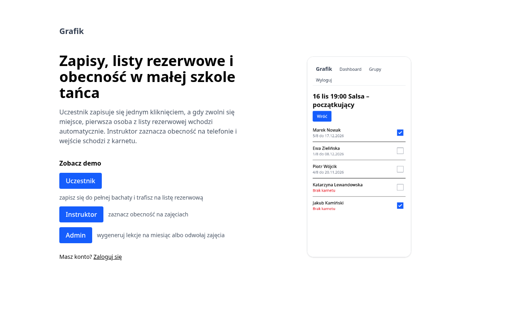
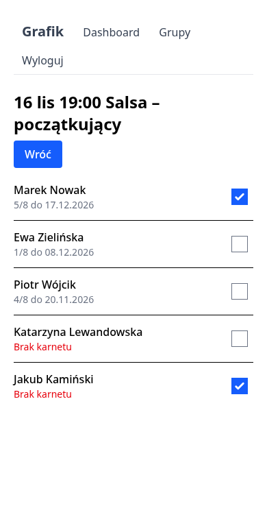
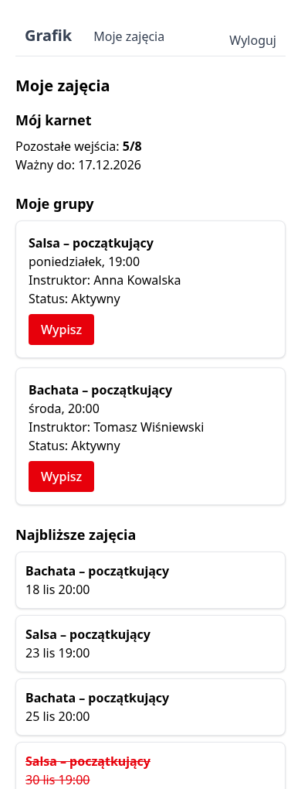
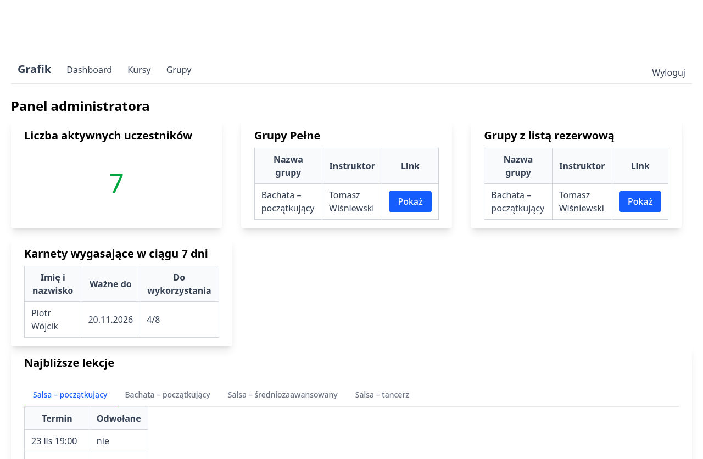

# Grafik — zapisy i obecność w szkole tańca


Aplikacja dla małej szkoły tańca: uczestnicy zapisują się na zajęcia z grafiku,
a gdy grupa jest pełna, trafiają na listę rezerwową. Instruktor sprawdza obecność
na telefonie, a każda obecność zdejmuje wejście z karnetu.



<p align="center">
  
  
</p>



## Funkcje

### Uczestnik

* przegląda grafik pogrupowany w zakładki dni tygodnia,
* zapisuje się i wypisuje jednym kliknięciem (Turbo Streams, bez przeładowania strony),
* gdy brak miejsc, trafia na listę rezerwową; gdy ktoś się wypisze, pierwsza osoba z listy automatycznie dostaje miejsce,
* w „Moich zajęciach” widzi swoje grupy, pozycję na liście rezerwowej, najbliższe zajęcia (odwołane są wyróżnione) i stan karnetu z ostrzeżeniem o ostatnim wejściu lub zbliżającym się końcu ważności.

### Instruktor

* na dashboardzie widzi najbliższe lekcje swoich grup,
* sprawdza obecność na telefonie (lista z checkboxami),
* zaznaczenie obecności zdejmuje wejście z karnetu, odznaczenie je zwraca, a ponowne kliknięcie nie zdejmuje drugiego wejścia,
* przy każdym uczestniku widzi stan karnetu albo informację o jego braku.

### Administrator

* zarządza kursami i grupami (dzień, godzina, instruktor, limit miejsc),
* generuje zajęcia grupy na cały miesiąc,
* odwołuje pojedyncze zajęcia,
* na dashboardzie widzi liczbę aktywnych uczestników, pełne grupy, grupy z listą rezerwową i karnety wygasające w ciągu 7 dni.

## Stack

* Ruby 3.4, Rails 8.1, SQLite
* Hotwire (Turbo Streams + Stimulus), importmap
* Tailwind CSS 4
* RSpec, FactoryBot, shoulda-matchers
* RuboCop, Brakeman, GitHub Actions

## Uruchomienie

```bash
git clone git@github.com:kamilszwaradzki/fullstack-ruby-on-rails.git
cd fullstack-ruby-on-rails
bin/setup
```

`bin/setup` instaluje gemy, tworzy bazę z danymi demo i uruchamia aplikację na http://localhost:3000.

Testy:

```bash
bundle exec rspec
```

## Konta demo

Na stronie startowej można zalogować się jednym kliknięciem na każdą rolę.

| Rola | E-mail | Hasło |
|---|---|---|
| Uczestnik | student@example.com | Student789! |
| Instruktor | instructor@example.com | Instructor456! |
| Administrator | admin@example.com | Admin123! |

Warto sprawdzić:

* **uczestnik**: wypisz się z pełnej grupy bachaty, a pierwsza osoba z listy rezerwowej dostanie miejsce,
* **instruktor**: zaznacz i odznacz obecność, a liczba wejść w karnecie zmieni się odpowiednio,
* **administrator**: wygeneruj zajęcia na kolejny miesiąc albo odwołaj lekcję.

## Decyzje techniczne

* **Serwisy**: logika zapisów, obecności i generowania zajęć jest w `EnrollmentService`, `AttendanceService` i `LessonsGeneratorService`, a nie w kontrolerach, dzięki czemu można ją testować osobno.
* **Transakcje i blokady**: zapis na zajęcia i zdejmowanie wejść działają w transakcji z `lock!`, więc dwa jednoczesne kliknięcia nie przekroczą limitu miejsc ani nie zdejmą dwóch wejść.
* **Idempotencja**: ponowne oznaczenie obecności nie zdejmuje kolejnego wejścia, a generator zajęć i seedy można uruchamiać wielokrotnie bez duplikatów.
* **Dostęp do danych**: rekordy są wyszukiwane przez `Current.user`, więc instruktor widzi tylko swoje grupy, a uczestnik nie wypisze cudzego zapisu; sprawdzają to request speci.
* **Turbo Streams**: jedna odpowiedź kontrolera odświeża kartę grupy na grafiku i usuwa ją z „Moich zajęć”.
* **Stimulus**: dwa małe kontrolery (zakładki i automatyczne wysyłanie checkboxa obecności) zamiast skryptów w widokach.

## Model danych

```
User        (email_address, name, role: admin/instructor/participant)
Course      (name, description, level)
Group       (course_id, instructor_id, weekday, starts_at, duration, capacity)
Lesson      (group_id, starts_at, cancelled_at)
Enrollment  (user_id, group_id, status: active/waitlisted/cancelled, position)
Pass        (user_id, entries_total, entries_left, valid_until)
Attendance  (lesson_id, user_id, pass_id, present)
```

## Testy

88 testów w RSpec: modele (walidacje i asocjacje), serwisy (zapisy, lista rezerwowa, obecność, generowanie zajęć) oraz request speci sprawdzające dostęp każdej roli i odpowiedzi Turbo Stream.

## Co dalej

* maile o odwołaniu zajęć i o awansie z listy rezerwowej,
* deploy wersji demo.
